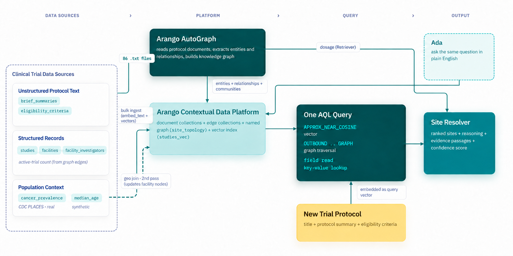
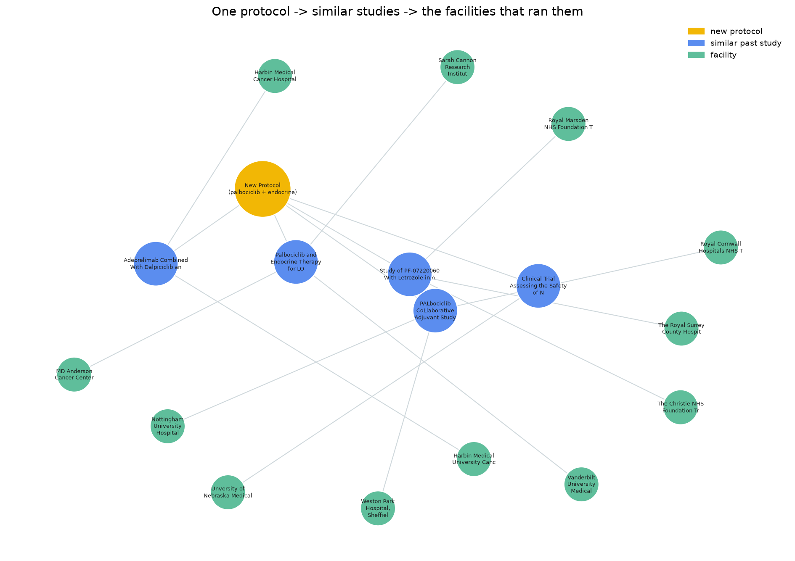
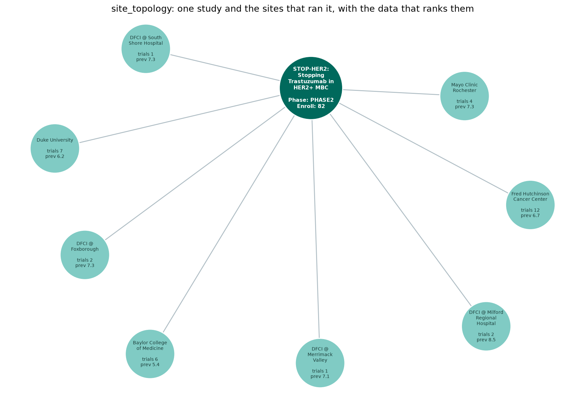
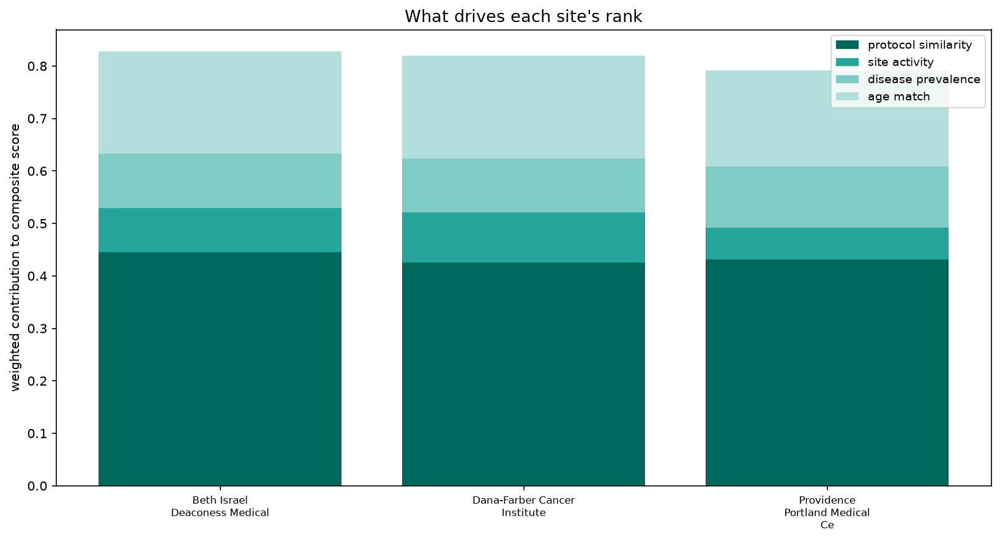
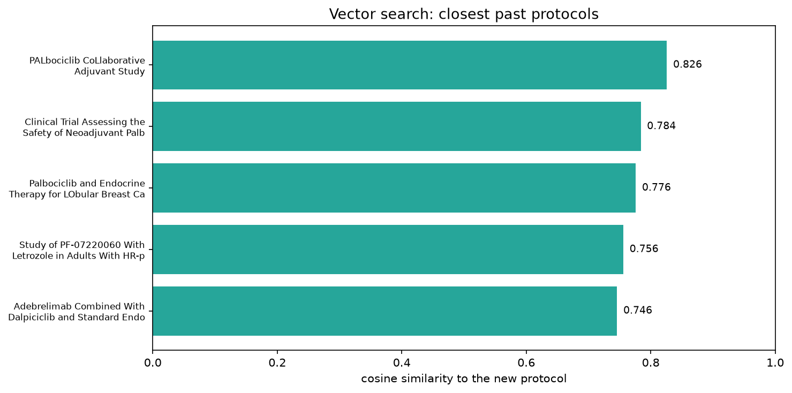
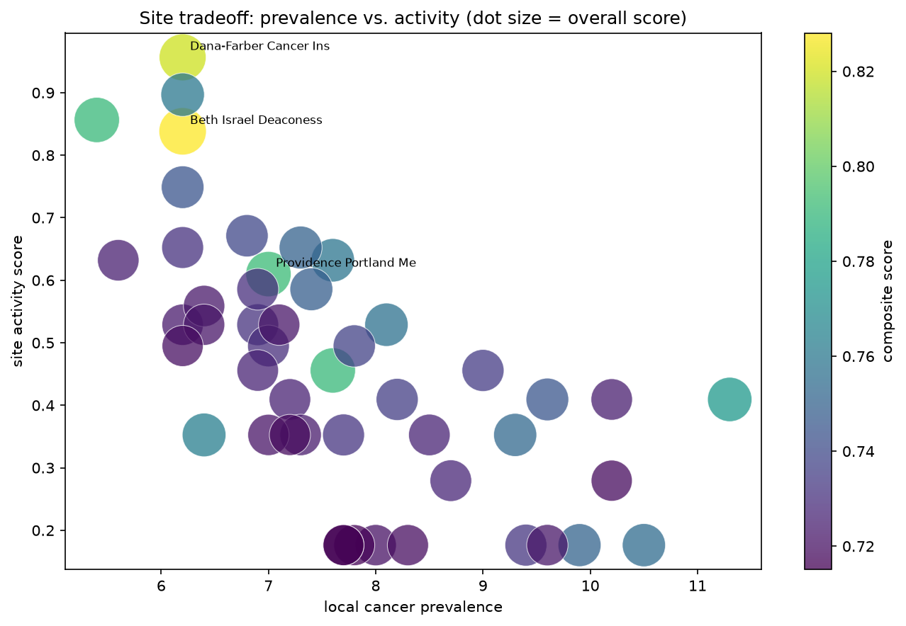

# Clinical Trial Site Recommender

**An explainable, multi-variable trial-site recommender that composes vector search, graph traversal, key-value lookup, and a context graph into a single workflow on the Arango Contextual Data Platform.**

> **Scope:** the median-age signal is a synthetic stand-in; every other ranking input is real. This project demonstrates the multimodel composition, not validated site rankings.


A new trial protocol comes in. The system finds the past studies closest to it in meaning, walks the graph to the facilities that ran them, and ranks each facility using four weighted variables. Dosage adds a fifth, supporting evidence variable through AutoGraph. The system returns a ranked recommendation with a per-variable breakdown, supporting evidence, and a confidence signal. Four data models, one workflow, without a separate vector store or graph database to manage.



## Why this exists

Selecting sites for an oncology trial means pulling evidence from trial registries, investigator databases, enrollment records, and protocol documents, then reconciling it by hand. Roughly 40 to 50 percent of chosen sites underperform or never enroll a patient, and each activation runs about $30,000. The cost is not a missing algorithm; it is that the signals live in four different shapes across four systems. This project holds all four in one store and ranks sites across them at once, rather than sorting on a single field.

## What drives a recommendation

| Variable | Signal | Source | Data model |
|----------|--------|--------|------------|
| Protocol | per-site relevance of the matched studies | embedded protocol text | vector index |
| Activity | count of active+recruiting trials at the site | graph traversal | graph |
| Prevalence | local cancer prevalence | CDC PLACES (real) | key-value |
| Demographics | local median-age fit | generated stand-in | key-value |
| Dosage | drug and schedule | AutoGraph context graph (local fallback) | context graph |

The ordering is carried by the two real, site-specific signals: protocol relevance
(45 percent) and local prevalence (25 percent). Site activity (10 percent) is a real,
log-scaled count of the active and recruiting interventional trials the site runs; it
reflects current activity, not historical outcomes. Only the median-age signal (20 percent)
is a synthetic stand-in for data that is not freely available by county without a key (see
**Design boundaries**); the output labels it `[synthetic]` so it is never mistaken for a
measured value. The earlier build weighted a random `success_score`; that has been removed
from the ranking entirely.

## The recommendation in one picture

The incoming protocol, the five studies closest to it in meaning, and the facilities that ran them.



## The query at the center

The four database-side variables resolve in a single AQL statement. The vector search sits in its own top-level `SORT` and `LIMIT`, which `APPROX_NEAR_COSINE` requires; the traversal and scoring follow. The weights and neutral stand-ins are passed as bind parameters (`@w_protocol`, `@neutral_prev`, and so on); their working values are listed in the comment below.

```aql
// Weights: protocol 0.45 · prevalence 0.25 · age 0.20 · activity 0.10
// Neutral stand-ins for sites without geo data: prevalence 0.3 · age 0.5
LET similar = (
    FOR s IN studies
        // nProbe must be >= the index's nLists (see ingest.VECTOR_NLISTS) so the
        // search probes every inverted list and returns the true nearest neighbours.
        LET sim = APPROX_NEAR_COSINE(s.embedding, @vec, { nProbe: 2 })
        SORT sim DESC
        LIMIT 5
        RETURN { nct_id: s.nct_id, title: s.brief_title, similarity: sim }
)

LET site_trials = (
    FOR study IN similar
        FOR v IN 1..@depth OUTBOUND CONCAT("studies/", study.nct_id) GRAPH "site_topology"
            FILTER IS_SAME_COLLECTION("facilities", v)
            FILTER v.name != null
            // Drop placeholder facility rows (e.g. "Research Site", "Local Institution - 0012").
            FILTER LOWER(v.name) NOT IN ["research site", "investigative site",
                                         "clinical research site", "site reference id"]
            FILTER LOWER(v.name) NOT LIKE "local institution%"
            FILTER LOWER(v.name) NOT LIKE "site %"
            // Stage 1: collapse to one row per (hospital identity, trial) first, so a
            // hospital listed several times inside one trial feeds the noisy-or once.
            COLLECT
                name = v.name, city = v.city, state = v.state, country = v.country,
                prevalence = v.cancer_prevalence,
                median_age = v.median_age, has_geo_data = (v.cancer_prevalence != null),
                nct_id = study.nct_id
            AGGREGATE sim = MAX(study.similarity)
            RETURN { name, city, state, country, prevalence, median_age, has_geo_data, nct_id, sim }
)

LET sites = (
    FOR r IN site_trials
        LET has_geo = r.has_geo_data
        // Geo sub-scores are clamped to [0,1] so no single variable outvotes the composite.
        LET prevalence_score = has_geo
                        ? MIN([1, MAX([0, r.prevalence / @prev_ref])]) : @neutral_prev
        LET age_score = (has_geo AND r.median_age != null)
                        ? MIN([1, MAX([0, (50 - ABS(r.median_age - 40)) / 50])]) : @neutral_age
        // Stage 2: group on facility identity. Each row is already one distinct trial
        // per hospital (stage 1), so the noisy-or counts each trial exactly once.
        COLLECT
            name = r.name, city = r.city, state = r.state, country = r.country,
            prevalence = r.prevalence, median_age = r.median_age, has_geo_data = has_geo
        AGGREGATE log_miss      = SUM(LOG(1 - MIN([0.999, MAX([0, r.sim])]))),
                  best_sim      = MAX(r.sim),
                  matched_count = COUNT_DISTINCT(r.nct_id),
                  prev_sub      = MAX(prevalence_score),
                  age_sub       = MAX(age_score)
        // Site activity: distinct active+recruiting interventional trials across ALL
        // facility records for this physical hospital, matched by the same identity.
        LET trial_count = LENGTH(
            FOR f IN facilities
                FILTER f.name == name AND f.city == city
                   AND f.state == state AND f.country == country
                FOR st IN 1..1 INBOUND f._id GRAPH "site_topology"
                    FILTER IS_SAME_COLLECTION("studies", st)
                    FILTER st.study_type == "INTERVENTIONAL"
                    FILTER st.overall_status IN ["ACTIVE_NOT_RECRUITING", "RECRUITING"]
                    RETURN DISTINCT st._key
        )
        // Protocol relevance is a PER-SITE aggregate: a bounded noisy-or over the
        // matched similarities, 1 - PRODUCT(1 - sim) = 1 - EXP(SUM(LOG(1 - sim))).
        LET protocol_score = 1 - EXP(log_miss)
        // Site activity, log-scaled so a very busy site does not dominate.
        LET activity_score = MIN([1, MAX([0, LOG(1 + trial_count) / LOG(1 + @activity_ref)])])
        LET composite = (protocol_score * @w_protocol)
                      + (activity_score * @w_activity)
                      + (prev_sub       * @w_prev)
                      + (age_sub        * @w_age)
        SORT composite DESC, matched_count DESC, best_sim DESC
        LIMIT @site_buffer   // a buffer; the resolver dedups to distinct sites then takes the top N
        RETURN {
            name, city, state, country, prevalence, median_age, has_geo_data,
            trial_count, activity_score,
            composite_score: composite, matched_similarity: protocol_score,
            best_similarity: best_sim, matched_count: matched_count,
            prevalence_score: prev_sub, age_score: age_sub
        }
)

RETURN { similar_studies: similar, recommended_sites: sites }
```

The traversal runs a single hop: the `site_topology` edges connect each study to the facilities that ran it, so the facilities are exactly one step out. The `@vec` bind parameter is the embedding of the incoming protocol, produced by `resolver.py` before the query runs. `CONCAT("studies/", study.nct_id)` builds each document handle directly, which works because a study's key is its NCT ID.

Dosage, the supporting fifth variable alongside the four ranked ones, comes from a separate AutoGraph Retriever call and is folded into the output. That call retries on transient failures, and if the Retriever returns nothing parseable the resolver falls back to the matched trials' own intervention text (the files `export_docs.py` writes), so a run is not left without a dose when the data exists. The output labels the source, either `AutoGraph context graph` or `trial intervention text (fallback)`. Sites missing population data are scored on neutral stand-ins rather than dropped, so a strong site outside the external-data coverage still surfaces, flagged for lower confidence.

## Example output

For a Phase III palbociclib plus endocrine therapy protocol (HR-positive, HER2-negative).
The shape of the output is below; the exact figures depend on your AACT snapshot and the
built database, so regenerate them with `python src/resolver.py data/protocol_sample.json`.

```
=== RECOMMENDED SITES (protocol + activity + prevalence + age) ===
1. Beth Israel Deaconess Medical Center -- Boston, United States    overall: 0.828
   ran 3 of the top matched studies (best match 0.826); 26 active trials at site
   Protocol relevance  0.99   (45%)
   Site activity       0.838  (10%)
   Disease prevalence  0.413  (25%)
   Age match           0.976  (20%)  [synthetic]
2. Dana-Farber Cancer Institute -- Boston, United States    overall: 0.82
   ran 2 of the top matched studies (best match 0.776); 42 active trials at site
   Protocol relevance  0.945  (45%)
   Site activity       0.957  (10%)
   Disease prevalence  0.413  (25%)
   Age match           0.976  (20%)  [synthetic]
3. Providence Portland Medical Center -- Portland, United States    overall: 0.792
   ran 2 of the top matched studies (best match 0.826); 10 active trials at site
   Protocol relevance  0.957  (45%)
   Site activity       0.61   (10%)
   Disease prevalence  0.467  (25%)
   Age match           0.916  (20%)  [synthetic]

=== DOSAGE EVIDENCE (AutoGraph context graph) ===
  - Palbociclib: 125 mg orally, 21 days on, 7 days off (Days 1-21 of each 28-day cycle)

=== REASONING ===
Beth Israel Deaconess Medical Center ranks first (composite 0.828). Dana-Farber is the
runner-up and scores higher on site activity (0.957 vs 0.838), but Beth Israel leads on
protocol relevance (0.99 vs 0.945), which carries more weight; prevalence and age are equal.
Dosage information was retrieved and is listed separately above.

=== CONFIDENCE ===
medium -- top two sites effectively tied (composites within 0.02); the ordering between
          them is within noise
```

Notes on reading the output: the per-variable `[synthetic]` tag marks the median-age signal.
Protocol relevance separates sites that ran several of the matched trials from those that ran
one; it is uniform only when every top site ran a single matched trial. Near-duplicate
facility records for one physical site (AACT carries several) are collapsed so the ranking
does not list the same place twice. Confidence is `medium` on a near-tie and `low` when the
protocol is off-topic (closest study below 0.75) or the dosage evidence is unrelated to the
matched trials.

The closest past study to the palbociclib protocol is PALLAS, a palbociclib adjuvant trial. The semantic match also reaches past exact wording: the fourth match compares a new CDK4 inhibitor with palbociclib, ribociclib or abemaciclib; its title never names palbociclib, so keyword search would rank it low, but the vector search finds it through shared clinical meaning. What makes this work is that Arango runs the semantic match and the graph traversal in the same query, so the recommendation reflects both what a protocol means and how sites connect to relevant trials.

## Repository layout

```
src/
  ingest.py        # AACT -> graph + embeddings + vector index (+ illustrative synthetic metadata)
  enrich.py        # joins CDC prevalence + demographics onto sites by geography
  export_docs.py   # writes the drug-class protocol docs for AutoGraph
  resolver.py      # the recommender over four ranked variables plus dosage: marquee query, reasoning, confidence
data/
  protocol_sample.json
assets/            # generated figures
site_recommender.ipynb   # end-to-end demonstration notebook
tests/
  test_scoring.py        # offline unit tests for the deterministic scoring logic
  test_integration.py    # property tests against a live, built database
requirements.txt
.env.example
```

## Build and run

```bash
git clone <this-repo>
cd clinical-trial-site-recommender
pip install -r requirements.txt
cp .env.example .env        # add Arango and OpenAI credentials, and the Retriever service ID
```

The build scripts run once to populate the database:

```bash
python scripts/build_aact_sample.py path/to/full_aact_export   # build data/aact_sample/ from the AACT download (gitignored, so build it first)
python src/ingest.py                  # load AACT, embed protocols, build the graph and vector index
python src/enrich.py                  # attach CDC prevalence and demographics by geography
python src/export_docs.py             # write protocol docs for upload to AutoGraph
```

`python src/ingest.py --rebuild` truncates the facilities collection, so re-run `python src/enrich.py` after any `--rebuild`.

Then set up the AutoGraph context graph in the Arango web UI (this supplies the dosage evidence):

1. Create an AutoGraph project.
2. Upload the documents in `data/autograph_docs/`.
3. Build the graph.
4. Deploy a Retriever service and copy its service ID into `RETRIEVER_SERVICE_ID` in `.env`.

With the database built and the Retriever deployed, a recommendation is a single command:

```bash
python src/resolver.py data/protocol_sample.json
```

`site_recommender.ipynb` runs the whole recommendation against an already-built database and generates the figures below.

## Prerequisites

- **Arango Contextual Data Platform:** Access to the [platform](https://arango.ai/) with the [Agentic AI Suite](https://docs.arango.ai/agentic-ai-suite/) enabled (AutoGraph and Ada access can be requested through the [demo page](https://arango.ai/demo/)).
- **Python:** [Python 3.12+](https://www.python.org/downloads/).
- **LLM provider:** An API key for an OpenAI-compatible LLM provider. The examples use OpenAI; set `OPENAI_BASE_URL` to use another compatible provider. That provider must serve the model names the code uses (`gpt-5-mini`, `text-embedding-3-small`), since these are fixed in the code.
- **Dataset:** The [AACT dataset](https://aact.ctti-clinicaltrials.org/) extracted into `data/aact_sample/`.

## What the pipeline produces

| | |
|---|---|
|  | **Topology.** One study and the sites that ran it, each carrying the data that ranks it. |
|  | **Score breakdown.** Every top site's per-variable contribution to its composite score. |
|  | **Vector search.** The closest past protocols by cosine similarity. |
|  | **Tradeoff.** Prevalence against activity across all candidates, sized by overall score. |

## Design boundaries and how to move past them

Every boundary below is a deliberate decision made against a real-world data constraint, with a clear path to production.

**Synthetic median age.** The live Census demographic API sits behind a key, so the median-age signal (20 percent) is generated and labelled `[synthetic]` in the output. It is a single, swappable layer: the schema, query, and scoring stay identical when the real Census county-age file replaces it. Prevalence is already real, pulled live from CDC PLACES, and site activity is a real count of active+recruiting interventional trials, so only this one weighted input is synthetic. The earlier build also weighted a random `success_score`; that signal has been removed from the ranking entirely.

**Trial type.** The study slice is restricted to `study_type == "INTERVENTIONAL"`, so observational registries do not surface as matches or inflate a site's activity count.

**Dosage corpus coverage.** The dosage knowledge graph should be built from the matched trials (for example, all CDK4/6 trials for a CDK4/6 protocol) so the Retriever's answer references the protocol's own drug class. A dosage answer that does not mention the matched trials is flagged, and confidence drops, rather than being presented as grounded. Because the AutoGraph Retriever is LLM-backed and can return nothing on a given run, the resolver retries and then falls back to the matched trials' own intervention text, so dosage is reliable whenever the dose exists in the trial record; the output always states which source was used.

**US-only population coverage.** CDC PLACES covers the United States, so international sites arrive without prevalence or age. Rather than dropping them, the resolver scores them on neutral stand-ins and lowers the confidence signal, so a strong overseas site still surfaces and is flagged honestly. Extending coverage is a matter of adding a second geographic source; the geography join already generalizes.

**Investigator entity resolution.** AACT records investigator identity as free-text names with no stable IDs, so the same person appears as several nodes. The recommendation rides on study-to-site links, which are clean, so the investigator side is present but not yet trusted. A resolution pass (blocking plus similarity matching on name and affiliation) collapses the duplicates and unlocks investigator-level reasoning.

**Context graph corpus size.** `export_docs.py` writes the full drug-class matched set by default (uncapped, `MAX_DOCS = None`), so the extracted dosages belong to the protocol's drug class rather than an arbitrary sample; rebuild the AutoGraph graph when the matched set changes. `MAX_DOCS` is an optional hard ceiling for a very large class. Scaling to a larger corpus is a settings change on the AutoGraph import.

None of these boundaries touch the core claim: four ranked variables plus dosage, four data models, one workflow, with real semantic search, real graph traversal, and real prevalence data already in place.

## Tests

`tests/test_scoring.py` covers the deterministic scoring logic with no database or network: the composite weights sum to 1.0, the clamp bounds, the margin-aware confidence downgrade, the dosage-line parser (drug/number/unit shape, multi-drug attribution, and truncation handling), the protocol input validation, and the reasoning soundness guard. `tests/test_integration.py` adds property checks against a live, built database — the vector search returns the same studies as an exact cosine scan (recall), the ranking is deterministic, and each composite equals its weighted sum — and skips automatically when no database credentials are set, so the offline suite still runs anywhere. `resolver.py` reads a few environment variables at import, so the offline tests set dummy values themselves; they make no API calls.

```bash
python -m pip install pytest
# offline unit tests only (no database/network):
PYTHONPATH=src python -m pytest tests/test_scoring.py -q      # Windows PowerShell: $env:PYTHONPATH="src"; python -m pytest tests/test_scoring.py -q
# full suite, including the live-stack property tests (needs a built DB + .env):
PYTHONPATH=src python -m pytest tests -q
```

## Extending it

Replace the synthetic layers with real CRM and census data; the schema does not change, only the source. Expand the AutoGraph corpus for richer entity extraction. Wrap `resolver.py` as a tool inside an agent framework to turn a single recommendation into a multi-step feasibility workflow: protocol intake, site shortlisting, investigator verification, activation scheduling.

## Acknowledgements

Built on the [Arango Contextual Data Platform](https://arango.ai/). Trial data from [AACT](https://aact.ctti-clinicaltrials.org/) (ClinicalTrials.gov). Cancer prevalence from [CDC PLACES](https://www.cdc.gov/places/).